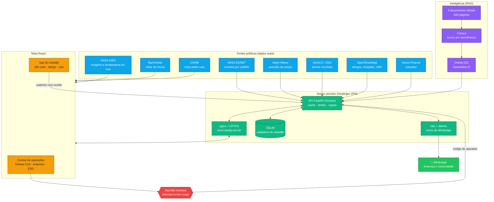
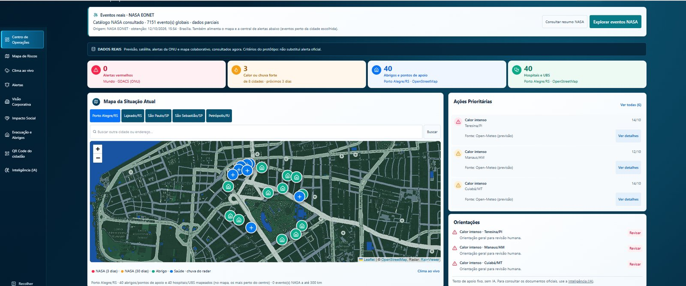
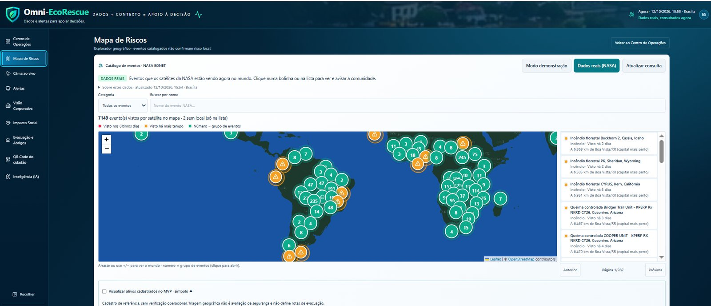
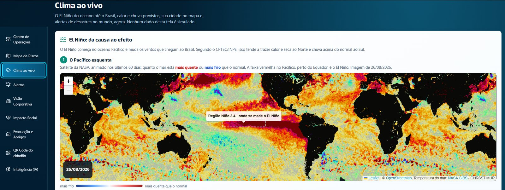
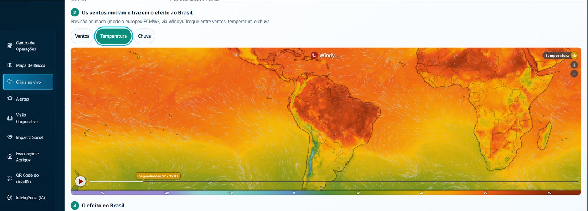
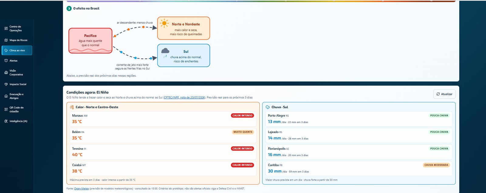
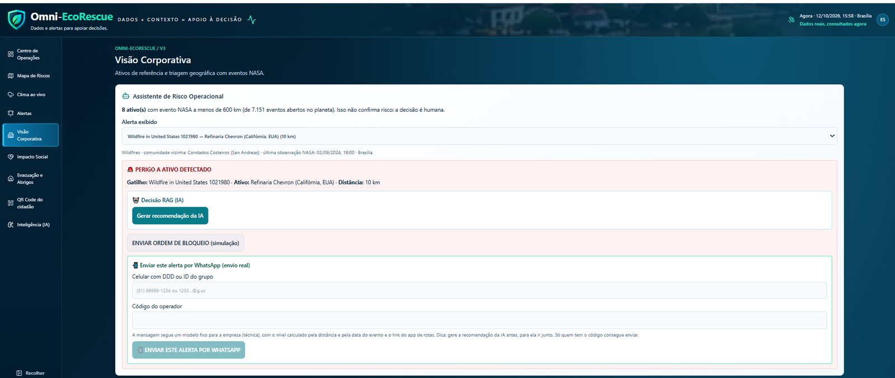
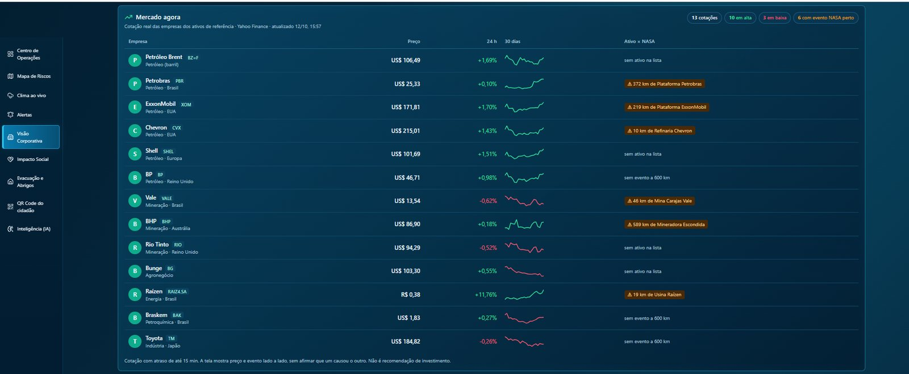
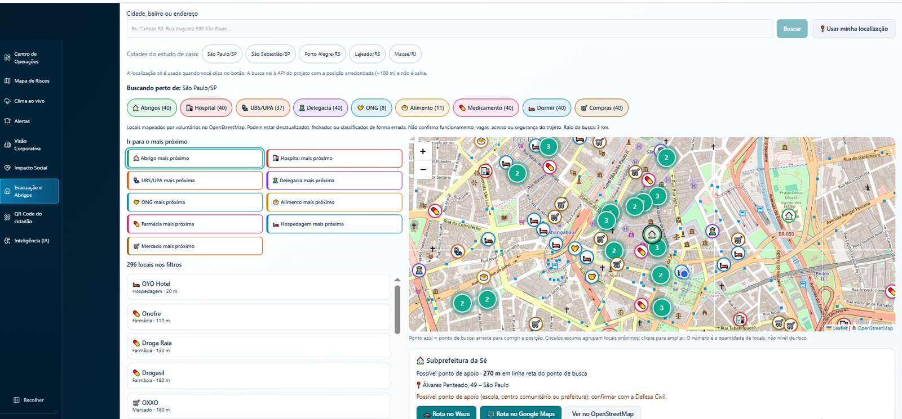
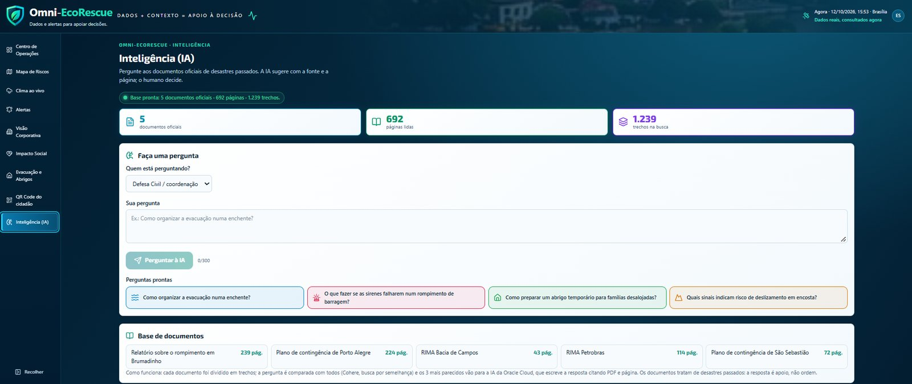

# Omni-EcoRescue V3

## A aplicação (React + API) — outubro/2026

**No ar:** central em https://omni.sandlj.com.br e tela do cidadão (celular) em https://omni.sandlj.com.br/cidadao.

Aplicação React/TypeScript com API FastAPI que junta dados públicos reais em um só lugar para **apoiar** a decisão humana (Defesa Civil, empresas e comunidades). Ela não faz previsão própria e não substitui alerta oficial. Toda tela abre com **dados reais**; o cenário fictício desenhado pela equipe só aparece no botão **"Modo demonstração"**, marcado como simulação.

| Tela | O que mostra (fonte real) |
|---|---|
| Centro de Operações | Indicadores, mapa da cidade, alertas, rota de evacuação, abrigos e saúde, satélite e radar (Open-Meteo, NASA EONET, GDACS/ONU, OpenStreetMap, OSRM, NASA GIBS, RainViewer) |
| Alertas | Lista única de alertas reais: calor/chuva previstos, eventos NASA a até 300 km de uma capital e alertas laranja/vermelho da ONU, com orientação e aviso por WhatsApp |
| Mapa de Riscos | Eventos abertos da NASA EONET no mundo, com nomes em português e aviso à comunidade |
| Clima ao vivo | El Niño (anomalia do mar, NASA GHRSST), previsão de calor e chuva, radar e alertas mundiais |
| Visão Corporativa | 11 ativos de referência × eventos NASA (raio de 600 km), recomendação da IA e cotações das empresas (Yahoo Finance) |
| Impacto Social | Comunidades vizinhas aos ativos de referência, recomendação da IA e aviso por WhatsApp |
| Evacuação e Abrigos | Abrigos, hospitais e UBS perto de qualquer endereço (OpenStreetMap), checklist da família e telefones oficiais |
| QR Code do cidadão | Cartaz com QR code: o cidadão acha o abrigo mais perto e se cadastra para alertas no WhatsApp |
| Inteligência (IA) | Perguntas respondidas com trechos de documentos oficiais (RAG: embeddings Cohere + Oracle OCI Generative AI), sempre citando PDF e página |

### Arquitetura



### Telas (capturas de outubro/2026, dados reais)

**Centro de Operações**: indicadores, mapa da cidade com abrigos e saúde, ações prioritárias e orientações.



**Mapa de Riscos**: eventos abertos da NASA no mundo, com nomes em português e a capital brasileira mais perto.



**Clima ao vivo**: El Niño visto por satélite, ventos e temperatura animados e o efeito previsto no Brasil.







**Visão Corporativa**: assistente de risco (evento NASA × ativo), recomendação da IA, envio por WhatsApp e mercado agora.





**Evacuação e Abrigos**: locais reais perto de qualquer endereço (OpenStreetMap) e o mais próximo de cada tipo.



**Inteligência (IA)**: perguntas respondidas com trechos de 5 documentos oficiais, citando PDF e página.



### Integrantes do Grupo 12

- **Liderança, Desenvolvimento Full Stack e IA**: Leonardo Junior Gonzales Mendoza (RM 373713). Aplicação React, API, IA (RAG com Oracle), servidor e integrações (NASA, WhatsApp).
- **Design das Telas e Modelo de Negócio**: Felipe Eunilio Vieira dos Santos (RM 369771). Desenho das telas (mockups), framework de produtização e posicionamento B2B com Human-in-the-Loop.
- **Desenvolvimento e Testes**: Helton Rosa da Silva Abadia (RM 360372). Ajustes técnicos, incluindo a correção do motor de alertas que bloqueava o disparo de múltiplos alertas.

### Como funciona o aviso por WhatsApp

O operador escolhe um alerta, pode pedir a recomendação da IA e digita o **código do operador**. A API monta a mensagem a partir de um **modelo fixo** (versão empresa ou comunidade, com o nível calculado pela distância e pela data do evento e o link do app do cidadão) e entrega ao n8n, que só confere o token e envia pelo WAHA. A IA não escreve a mensagem: nada de endereço ou ordem inventada. Os botões "ordem de bloqueio" e "acionar lideranças" são simulação e não enviam nada.

### Segurança e privacidade

- Nenhuma chave fica no código. As credenciais ficam só no servidor, em `deploy/ia.env` (ignorado pelo Git e gerado por `deploy/gerar_ia_env.py`): `COHERE_API_KEY`, `OCI_*`, `CADASTROS_TOKEN`, `CADASTRO_WEBHOOK_URL`, `N8N_ALERTA_URL` e `OPERADOR_CODIGO`.
- A API roda em Docker e só aceita conexões locais (`127.0.0.1:8010`), atrás do nginx com HTTPS.
- Cadastro do cidadão (LGPD): só celular, CEP e nome opcional, com aceite explícito e opção de sair. Fica em SQLite no nosso servidor; a lista só sai com o token do servidor.
- Limites contra abuso: perguntas à IA por minuto, cadastros por hora e envios de WhatsApp por hora.

### Como rodar localmente

```bash
# API (Python 3.14, na raiz do repositório)
python -m venv backend/api/.venv
backend/api/.venv/Scripts/python -m pip install -r backend/api/requirements-lock.txt   # Linux/Mac: backend/api/.venv/bin/python
backend/api/.venv/Scripts/python -m uvicorn backend.api.main:app --host 127.0.0.1 --port 8000

# Telas (Node 22.18+), em outro terminal
cd frontend-react && npm ci && npm run dev    # http://127.0.0.1:5173
```

Sem `deploy/ia.env` tudo funciona, menos a IA e o WhatsApp, que avisam que não estão configurados. Testes: `cd frontend-react && npm test && npm run typecheck` e `python -m unittest discover -s backend/api/tests -t .`. Publicação no servidor: `bash deploy/deploy.sh`.

### Limites conhecidos (honestos)

- Critérios do protótipo, não oficiais: calor a partir de 35 °C, chuva forte a partir de 50 mm/dia, eventos NASA dos últimos 30 dias.
- Os 11 ativos são uma carteira de referência (empresas reais, posições aproximadas); uma empresa cliente cadastraria os próprios ativos.
- A rota de evacuação é a mais curta pelas ruas (OSRM) e não sabe de alagamento ou bloqueio.
- Abrigos do OpenStreetMap são mapeados por voluntários: não confirmam vaga nem funcionamento.
- Cotações com atraso de até 15 minutos; preço e evento aparecem lado a lado, sem afirmar causa.
- Os dados dependem da disponibilidade das fontes públicas; quando uma cai, a tela avisa e mostra a última resposta boa quando existe.

## O Problema

Desastres climáticos severos atingem infraestruturas industriais críticas. A falta de precisão na tomada de decisão gera duas consequências:

- **Dano Corporativo**: perda estrutural e desvalorização de ativos.
- **Dano Social**: comunidades vizinhas (pescadores, ribeirinhos) afetadas por riscos secundários (vazamentos, contaminação) sem tempo hábil para evacuação.

## Estudo de Caso

Bacia de Campos (RJ) — infraestrutura da Petrobras e Colônia de Pescadores Z3 de Macaé, que já possui vínculo formal com a Petrobras via Plano de Compensação Ambiental exigido pelo IBAMA.

## Documentação completa

Ver `docs/documentacao_oficial_pitch.md` para a documentação oficial do projeto, incluindo a base legal (CONAMA/EIA-RIMA) e o modelo de negócio detalhado.

## Próximos passos

1. Validação de campo com a Defesa Civil e com colônias de pescadores.
2. Carteira de ativos real de uma empresa cliente, no lugar da carteira de referência.
3. Envio de alertas por CEP para os cidadãos cadastrados, com aprovação humana.
4. Integração com os alertas oficiais (Defesa Civil / SMS 40199) e monitoramento de falhas das fontes.
