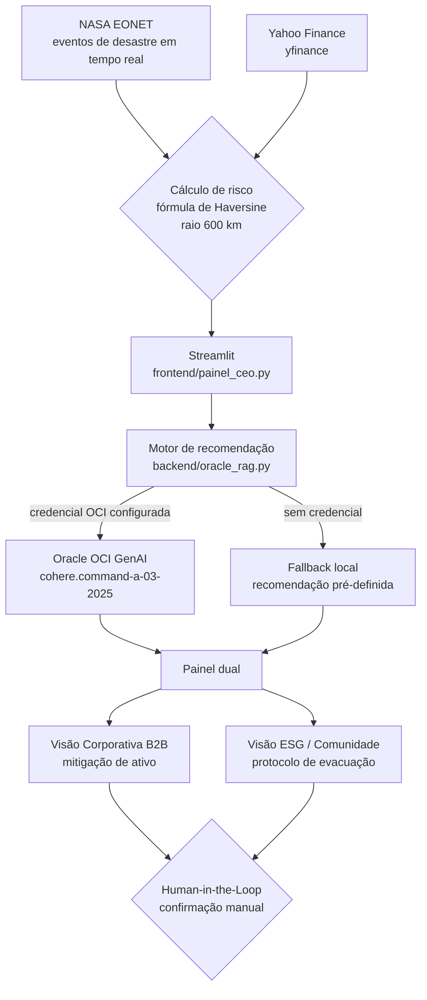
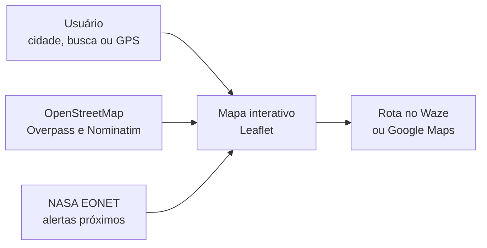
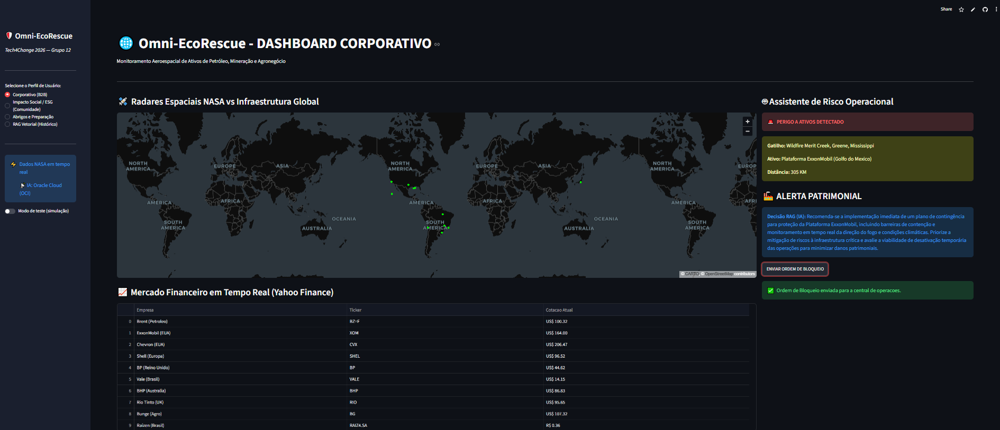
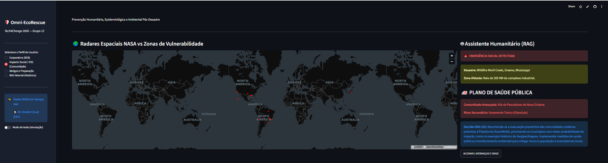
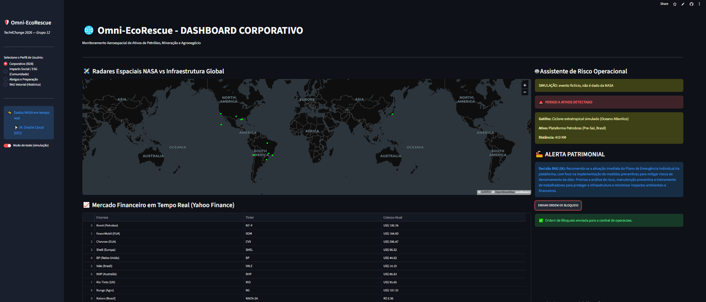
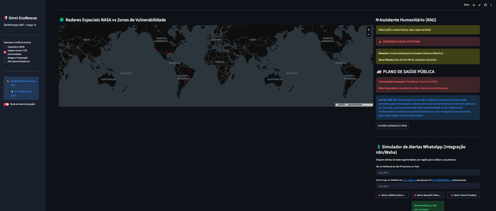
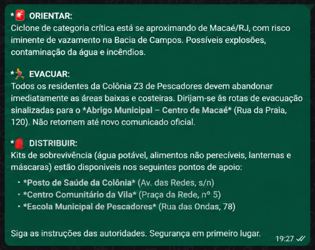

# Omni-EcoRescue V3

## Aplicação atual (React + API) — outubro/2026

**No ar:** central em https://omni.sandlj.com.br e tela do cidadão (celular) em https://omni.sandlj.com.br/cidadao.

Aplicação React/TypeScript com API FastAPI que junta dados públicos reais em um só lugar para **apoiar** a decisão humana (Defesa Civil, empresas e comunidades). Ela não faz previsão própria e não substitui alerta oficial. Toda tela abre com **dados reais**; o cenário fictício desenhado pela equipe só aparece no botão **"Modo demonstração"**, marcado como simulação.

| Tela | O que mostra (fonte real) |
|---|---|
| Centro de Operações | Indicadores, mapa da cidade, alertas, rota de evacuação, abrigos e saúde, satélite e radar (Open-Meteo, NASA EONET, GDACS/ONU, OpenStreetMap, OSRM, NASA GIBS, RainViewer) |
| Alertas | Lista única de alertas reais: calor/chuva previstos, eventos NASA a até 300 km de uma capital e alertas laranja/vermelho da ONU, com orientação e aviso por WhatsApp |
| Mapa de Riscos | Eventos abertos da NASA EONET no mundo, com nomes em português e aviso à comunidade |
| Clima ao vivo | El Niño (anomalia do mar, NASA GHRSST), previsão de calor e chuva, radar e alertas mundiais |
| Visão Corporativa | 11 ativos de referência × eventos NASA (raio de 600 km), recomendação da IA e cotações das empresas (Yahoo Finance) |
| Impacto Social | Comunidades vizinhas aos ativos de referência, recomendação da IA e aviso por WhatsApp |
| Evacuação e Abrigos | Abrigos, hospitais e UBS perto de qualquer endereço (OpenStreetMap), checklist da família e telefones oficiais |
| QR Code do cidadão | Cartaz com QR code: o cidadão acha o abrigo mais perto e se cadastra para alertas no WhatsApp |
| Inteligência (IA) | Perguntas respondidas com trechos de documentos oficiais (RAG: embeddings Cohere + Oracle OCI Generative AI), sempre citando PDF e página |

### Como funciona o aviso por WhatsApp

O operador escolhe um alerta, pode pedir a recomendação da IA e digita o **código do operador**. A API monta a mensagem a partir de um **modelo fixo** (versão empresa ou comunidade, com o nível calculado pela distância e pela data do evento e o link do app do cidadão) e entrega ao n8n, que só confere o token e envia pelo WAHA. A IA não escreve a mensagem: nada de endereço ou ordem inventada. Os botões "ordem de bloqueio" e "acionar lideranças" são simulação e não enviam nada.

### Segurança e privacidade

- Nenhuma chave fica no código. As credenciais ficam só no servidor, em `deploy/ia.env` (ignorado pelo Git e gerado por `deploy/gerar_ia_env.py`): `COHERE_API_KEY`, `OCI_*`, `CADASTROS_TOKEN`, `CADASTRO_WEBHOOK_URL`, `N8N_ALERTA_URL` e `OPERADOR_CODIGO`.
- A API roda em Docker e só aceita conexões locais (`127.0.0.1:8010`), atrás do nginx com HTTPS.
- Cadastro do cidadão (LGPD): só celular, CEP e nome opcional, com aceite explícito e opção de sair. Fica em SQLite no nosso servidor; a lista só sai com o token do servidor.
- Limites contra abuso: perguntas à IA por minuto, cadastros por hora e envios de WhatsApp por hora.

### Como rodar localmente

```bash
# API (Python 3.14, na raiz do repositório)
python -m venv backend/api/.venv
backend/api/.venv/Scripts/python -m pip install -r backend/api/requirements-lock.txt   # Linux/Mac: backend/api/.venv/bin/python
backend/api/.venv/Scripts/python -m uvicorn backend.api.main:app --host 127.0.0.1 --port 8000

# Telas (Node 22.18+), em outro terminal
cd frontend-react && npm ci && npm run dev    # http://127.0.0.1:5173
```

Sem `deploy/ia.env` tudo funciona, menos a IA e o WhatsApp, que avisam que não estão configurados. Testes: `cd frontend-react && npm test && npm run typecheck` e `python -m unittest discover -s backend/api/tests -t .`. Publicação no servidor: `bash deploy/deploy.sh`.

### Limites conhecidos (honestos)

- Critérios do protótipo, não oficiais: calor a partir de 35 °C, chuva forte a partir de 50 mm/dia, eventos NASA dos últimos 30 dias.
- Os 11 ativos são uma carteira de referência (empresas reais, posições aproximadas); uma empresa cliente cadastraria os próprios ativos.
- A rota de evacuação é a mais curta pelas ruas (OSRM) e não sabe de alagamento ou bloqueio.
- Abrigos do OpenStreetMap são mapeados por voluntários: não confirmam vaga nem funcionamento.
- Cotações com atraso de até 15 minutos; preço e evento aparecem lado a lado, sem afirmar causa.
- Os dados dependem da disponibilidade das fontes públicas; quando uma cai, a tela avisa e mostra a última resposta boa quando existe.

## Painel legado Streamlit

As seções seguintes documentam o painel legado (Streamlit), primeira versão do projeto. A aplicação atual (acima) já traz para o React a NASA, a IA da Oracle, as cotações do Yahoo Finance e o WhatsApp.

**Versão legada publicada (Streamlit):** [https://aplicativo-geo-capital-engine-3k7pun8ggkjwsyvgb2pgvm.streamlit.app/](https://aplicativo-geo-capital-engine-3k7pun8ggkjwsyvgb2pgvm.streamlit.app/)

Painel legado que cruza dados de eventos NASA com ativos industriais globais (plataformas offshore, mineração, agronegócio) para contextualizar decisões corporativas e comunitárias. Proximidade não confirma risco nem constitui previsão própria.

Projeto desenvolvido para o Hackathon "Tech for Change".

---

## O Problema

Desastres climáticos severos atingem infraestruturas industriais críticas. A falta de precisão na tomada de decisão gera duas consequências:

- **Dano Corporativo**: perda estrutural e desvalorização de ativos.
- **Dano Social**: comunidades vizinhas (pescadores, ribeirinhos) afetadas por riscos secundários (vazamentos, contaminação) sem tempo hábil para evacuação.

## A Solução

Painel com três visões. As duas primeiras apresentam, para o mesmo evento de risco, duas perspectivas:

- **Visão Corporativa (B2B)**: cruza a localização do evento (NASA EONET) com o valor de mercado do ativo (Yahoo Finance) e recomenda ação de mitigação.
- **Visão de Impacto Social (ESG/Comunidade)**: identifica a comunidade vizinha ao ativo e recomenda protocolo de evacuação/suporte humanitário.

- **Abrigos e Preparação (Comunidade)**: mapa interativo para localizar abrigos de evacuação e serviços essenciais próximos (hospitais, UBS/UPA, delegacias, ONGs, farmácias, mercados, alimentação e hospedagem), com alertas NASA e checklist de sobrevivência.

Nas visões Corporativa e ESG, o sistema recomenda — a decisão final e o acionamento de qualquer ação são sempre confirmados por um humano, via botão no painel (Human-in-the-Loop).

## Estudo de Caso

Bacia de Campos (RJ) — infraestrutura da Petrobras e Colônia de Pescadores Z3 de Macaé, que já possui vínculo formal com a Petrobras via Plano de Compensação Ambiental exigido pelo IBAMA.

## Arquitetura do painel legado

| Camada | Tecnologia |
|---|---|
| Frontend | Streamlit (`frontend/painel_ceo.py`) |
| Cálculo de risco geoespacial | `math` (fórmula de Haversine, raio de 600 km) |
| Dados de desastres | NASA EONET (tempo real) |
| Dados de mercado | Yahoo Finance (`yfinance`) |
| Mapa de abrigos | Leaflet (`frontend/mapa_interativo.py`) com locais do OpenStreetMap via Overpass API e busca de cidade via Nominatim |
| Rotas | Link para Waze ou Google Maps, partindo do ponto "você está aqui" |
| Inteligência Artificial | Oracle OCI Generative AI (`cohere.command-a-03-2025`), com fallback local seguro |

### Fluxo do sistema



### Visão Abrigos e Preparação

Terceira opção do menu lateral, organizada em três abas:

- **Mapa de Abrigos**: o usuário escolhe a cidade (ou busca outra, ou usa o GPS) e o mapa mostra abrigos cadastrados no MVP e locais reais buscados no OpenStreetMap, filtráveis por categoria. Ao clicar em um ponto, abre-se a rota no Waze ou no Google Maps. Se a busca no OpenStreetMap falhar, entra uma lista de reserva ilustrativa.
- **Central de Alertas**: cruza eventos ativos da NASA EONET com os abrigos cadastrados (raio de 600 km) e lista os que estão em risco.
- **Checklist de Sobrevivência**: lista de itens de preparação, com indicação do nível de preparo.

Fluxo do mapa de abrigos:



## Como rodar o painel legado localmente

```bash
# 1. Instalar dependências
pip install streamlit requests yfinance pandas oci

# 2. Rodar o painel (a partir da pasta raiz do projeto)
streamlit run frontend/painel_ceo.py
```

Rodando localmente, o app abre em http://localhost:8501. Para usar sem instalar nada, acesse a versão publicada na nuvem: https://aplicativo-geo-capital-engine-3k7pun8ggkjwsyvgb2pgvm.streamlit.app/

### Integração com Oracle (opcional)

O motor de recomendação (`backend/oracle_rag.py`) funciona em dois modos:

- **Real**: requer o SDK `oci` instalado e a variável de ambiente `OCI_COMPARTMENT_ID` configurada, além do arquivo de credenciais `~/.oci/config`.
- **Fallback (padrão)**: se a credencial não estiver configurada, o sistema usa uma recomendação local pré-definida, mantendo o painel estável em demonstrações públicas.

## Capturas de tela (versão publicada no Streamlit Cloud)

**Visão Corporativa (B2B)** — cruza o evento de risco (NASA EONET) com o ativo industrial mais próximo e recomenda ação de mitigação.



**Visão de Impacto Social / ESG (Comunidade)** — identifica a comunidade vizinha ao evento e recomenda protocolo de evacuação/suporte humanitário.



**Modo de teste (simulação)** — evento fictício (ciclone extratropical a 410 km da plataforma Petrobras), identificado na tela como simulação. Serve para demonstrar o caso da Bacia de Campos quando não há alerta real da NASA.



**Alerta por WhatsApp (protótipo)** — no fim da aba ESG, o Simulador de Alertas WhatsApp envia o evento ao n8n, que gera a mensagem (orientar, evacuar, distribuir) e a envia pelo WhatsApp via Waha. O envio é real, mas o texto é gerado por IA e **os endereços e pontos de apoio citados na mensagem são fictícios**: o protótipo ainda não usa a base real de abrigos. Na imagem, o endereço do webhook e o ID do grupo foram ocultados.





## Documentação completa

Ver `docs/documentacao_oficial_pitch.md` para a documentação oficial do projeto, incluindo a base legal (CONAMA/EIA-RIMA) e o modelo de negócio detalhado.

## Status do painel legado (MVP de Hackathon)

- [OK] Cálculo de risco geoespacial funcional
- [OK] Integração real com NASA EONET e Yahoo Finance
- [OK] Visão Abrigos e Preparação: mapa interativo com locais do OpenStreetMap, rotas no Waze/Google Maps, Central de Alertas NASA e checklist
- [OK] Human-in-the-Loop implementado no painel: a ação (simulada) só ocorre após o clique de confirmação do gestor
- [EM ANDAMENTO] Integração com Oracle GenAI: implementada, sujeita a fallback conforme disponibilidade de credencial
- [EM ANDAMENTO] Scripts em `backend/central_executiva.py` e `backend/omni_engine_alertas.py` são provas de conceito isoladas, não conectadas ao painel principal

## Equipe e Contribuições

- **Leonardo Junior Gonzales Mendoza** (RM 373713) — desenvolvimento do painel em Python/Streamlit, integração com as APIs geoespaciais e financeiras, estruturação da arquitetura de IA (Oracle GenAI) e infraestrutura do repositório.
- **Felipe Eunilio Vieira dos Santos** (RM 369771) — concepção do framework de produtização e modelo de negócio (documento "Decision Intelligence"), incluindo o posicionamento B2B e a lógica de Human-in-the-Loop aplicada à solução.
- **Helton Rosa da Silva Abadia** (RM 360372) — ajustes técnicos no código, incluindo correção de um bug no motor de alertas que bloqueava o disparo de múltiplos alertas; alterações já enviadas ao GitHub e em processo de integração à branch principal.

## Limitações conhecidas

- A IA generativa da Oracle roda em modo de fallback na demonstração pública: sem credencial OCI, o sistema usa uma recomendação local pré-definida.
- Os botões de ação do painel (bloqueio, ONGs, resgate) só exibem a confirmação na tela (simulação). O único envio real é o Simulador de Alertas WhatsApp (protótipo, via n8n e Waha), cujo texto é gerado por IA e traz endereços fictícios. SMS e sirene ainda não estão implementados.
- O nome "RAG" no painel se refere ao motor de recomendação; a etapa de recuperação de dados (ex.: base do EIA/RIMA) é um próximo passo.
- A base de 6 ativos e comunidades do MVP é ilustrativa e fixa no código; o estudo de caso da Bacia de Campos é um cenário de referência.
- Os scripts `backend/central_executiva.py` e `backend/omni_engine_alertas.py` são provas de conceito isoladas, não conectadas ao painel principal.
- Os dados dependem da disponibilidade das APIs públicas (NASA EONET, Yahoo Finance, Overpass e Nominatim).
- No mapa de abrigos, a classificação dos locais do OpenStreetMap é feita pelo nome e pelas tags; locais mal nomeados ou sem tags podem ficar de fora ou aparecer na categoria errada. Os abrigos são cadastrados no MVP, com coordenadas aproximadas.
- A Central de Alertas usa recomendação local pré-definida, sem chamar o Oracle GenAI.
- A validação com usuários ainda é inicial; a validação de campo com comunidades reais é um próximo passo.

## Próximos passos

1. Validação de campo com colônias de pescadores e mentores do setor.
2. Integração ativa com o Oracle GenAI (`cohere.command-a-03-2025`) em produção.
3. Parceria piloto com uma operadora para acessar dados reais de EIA/RIMA.
4. Canal de disparo real (SMS/WhatsApp) para lideranças comunitárias.
